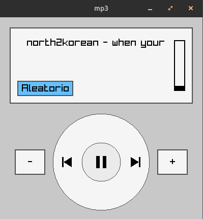

# mp3

Um player de MP3 simples feito em C++ com [raylib](https://www.raylib.com), com playlist, modo aleatório e controle de volume, em uma interface inspirada nos players portáteis clássicos.



## Funcionalidades

- Playlist montada automaticamente a partir de uma pasta com arquivos `.mp3`, em ordem alfabética
- Reproduzir/pausar, faixa anterior e próxima faixa
- Avanço automático para a próxima música quando a atual termina
- Modo aleatório (ao ligar ou desligar, a faixa atual continua tocando)
- Controle de volume em passos de 10%, com barra indicadora na tela
- Nome da música rolando na tela, como em um letreiro
- Janela de tamanho fixo (400x400)

## Controles

Todos os controles são feitos com o mouse:

| Controle | Ação |
|---|---|
| Botão central da roda | Pausar / retomar |
| Botão esquerdo da roda | Faixa anterior |
| Botão direito da roda | Próxima faixa |
| Botão **Aleatorio** | Liga/desliga o modo aleatório |
| Botões **-** e **+** | Diminui/aumenta o volume em 10% |

## Requisitos

- Compilador com suporte a C++17 (GCC ou Clang)
- [CMake](https://cmake.org) 3.14 ou superior
- Git

O projeto usa a raylib **6.0**. Se ela estiver instalada no sistema, o CMake a utiliza. Caso contrário, ele baixa e compila a raylib automaticamente na primeira compilação (isso pode levar alguns minutos).

### Dependências no Linux

Para compilar a raylib, são necessários os pacotes de desenvolvimento de áudio e vídeo. No Ubuntu/Debian:

```bash
sudo apt install build-essential cmake git libasound2-dev libx11-dev \
    libxrandr-dev libxi-dev libgl1-mesa-dev libxcursor-dev libxinerama-dev
```

Em outras distribuições, procure os pacotes equivalentes. Veja também o [guia da raylib para Linux](https://github.com/raysan5/raylib/wiki/Working-on-GNU-Linux).

## Compilar e executar

```bash
git clone <url-do-repositorio>
cd mp3
cmake -B build
cmake --build build
```

O executável é gerado em `build/bin/mp3`. Execute-o **a partir da raiz do projeto**, para que a pasta `assets` seja encontrada:

```bash
./build/bin/mp3
```

Para tocar músicas de outra pasta, passe o caminho como argumento:

```bash
./build/bin/mp3 ~/Musicas
```

O script `run.sh` compila e executa o projeto em um passo só.

## Músicas

Coloque seus arquivos `.mp3` na pasta `assets/`. As músicas **não** fazem parte do repositório (o `.gitignore` ignora arquivos de áudio).

Por enquanto:

- apenas arquivos `.mp3` são carregados;
- subpastas não são varridas, só os arquivos diretamente dentro da pasta indicada.

## Estrutura do projeto

```
.
├── assets/          # suas músicas (.mp3)
├── docs/            # imagens usadas neste README
├── main.cpp         # janela, layout e laço principal
├── player.h/.cpp    # playlist, reprodução, aleatório e volume
├── ui.h/.cpp        # botões, roda de controle, barra de volume e letreiro
├── CMakeLists.txt
└── run.sh
```

## Solução de problemas

**A janela abre com a mensagem "Nenhuma musica encontrada".**
Confira se há arquivos `.mp3` na pasta `assets/` e se você está executando o programa a partir da raiz do projeto (a pasta é procurada em relação ao diretório de onde o programa é executado). Você também pode indicar a pasta diretamente: `./build/bin/mp3 /caminho/para/as/musicas`.

**Erro ao compilar a raylib no Linux.**
Verifique se os pacotes listados em [Dependências no Linux](#dependências-no-linux) estão instalados.

## Créditos

Feito com [raylib](https://www.raylib.com), uma biblioteca simples para programação de jogos e aplicações gráficas em C.
